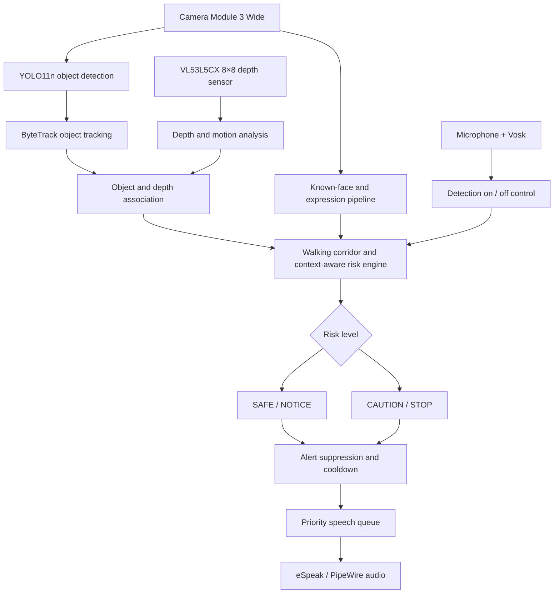

<div align="center">

# 🧢 WHISPERING HAT

### See the world. Hear what matters.

**A privacy-first wearable that combines computer vision, spatial sensing, and edge AI to turn surroundings into timely spoken alerts.**

<br>


<sub><strong>THE PROTOTYPE</strong> · Designed & developed by Om Chatterjee · 2026</sub>

<br><br>


<br>

**[▶ WATCH THE DEMO](https://www.youtube.com/watch?v=bRwE4cI1WvA)** &nbsp; | &nbsp; **[⌘ EXPLORE THE CODE](https://github.com/overcharged-coder/WhisperingHat)**

</div>

<br>

<table>
<tr>
<td align="center" width="33%"><strong>👁️ SEE</strong><br><sub>Detect and track relevant objects</sub></td>
<td align="center" width="33%"><strong>📡 UNDERSTAND</strong><br><sub>Combine depth, motion and walking-path context</sub></td>
<td align="center" width="33%"><strong>🔊 SPEAK</strong><br><sub>Deliver short, prioritized voice alerts</sub></td>
</tr>
</table>

> [!IMPORTANT]
> **Not another camera that narrates everything.** Whispering Hat is designed to decide *which* observations deserve the wearer's attention, and when.

---

## ✨ The Idea

**What if a wearable device could tell you not just what is nearby, but what actually matters?**

Whispering Hat is an experimental assistive technology project designed to help blind and visually impaired people become more aware of nearby obstacles and their surroundings. A camera, spatial depth sensor, and on-device AI models work together to assess the scene. Rather than narrating every detected object, the system prioritizes **short, timely audio alerts** about relevant obstructions and changes.

The entire core pipeline runs **locally on a Raspberry Pi 5**, without cloud inference or a Wi-Fi connection during operation.

> **Design principle:** Detect what is present. Understand what is changing. Speak only when the information is useful.

## 🧭 Explore

[Features](#-key-capabilities) · [How It Works](#-how-it-works) · [Architecture](#-system-architecture) · [Hardware](#-hardware) · [Software](#-software-stack) · [Run](#-getting-started) · [Demo](#-demonstration) · [Engineering](#-engineering-challenges) · [Safety](#-limitations--safety) 

## ⚡ Key Capabilities

| Capability | How it helps |
|:--|:--|
| 👁️ **Real-time object detection** | YOLO11n identifies relevant objects in the camera's field of view. |
| 📍 **Spatial depth awareness** | An 8×8 VL53L5CX Time-of-Flight sensor provides independent distance measurements. |
| 🚶 **Walking-path prioritization** | Objects in the predicted forward walking corridor receive more attention than objects off to the side. |
| 🔁 **Object tracking** | ByteTrack keeps identities across frames to help reason about movement and changing proximity. |
| ⚠️ **Context-aware risk assessment** | Distance, motion, object category, and prior alerts contribute to SAFE, NOTICE, CAUTION, and STOP decisions. |
| 🔊 **Spoken guidance** | An offline speech system announces concise alerts, prioritizing urgent warnings. |
| 🗣️ **Voice commands** | Local recognition supports “detection on” and “detection off.” |
| 👤 **Known-person recognition** | Locally stored face encodings can identify familiar people. |
| 🙂 **Expression estimation** | A local TensorFlow Lite model can label visible facial expressions as optional social context. |
| 🔒 **Offline by design** | Core perception, reasoning, recognition, and speech run on the device. |

## 🔄 How It Works

The system follows a sensor-fusion pipeline rather than treating camera detection as the final answer.



### 01 · See

The Raspberry Pi Camera Module 3 Wide captures a **640 × 480** video stream using Picamera2 and libcamera. A background camera worker keeps the most recent frame available rather than allowing old frames to accumulate.

### 02 · Detect and track

**YOLO11n** identifies selected object categories, while **ByteTrack** follows objects over time. The system can therefore reason about changes instead of reacting to each frame in isolation.

### 03 · Measure distance

The **VL53L5CX** Time-of-Flight sensor supplies an **8 × 8 spatial distance grid**. Camera detections and depth information are combined to estimate how near an obstruction is and whether it may be approaching.

### 04 · Assess risk

A rule-based risk engine considers the walking corridor, object position, category, distance, approach signals, and alert history. Its output ranges from **SAFE** to **STOP**, with repeated messages suppressed when appropriate.

### 05 · Speak when useful

A prioritized audio queue sends concise alerts to **eSpeak / PipeWire**. Urgent STOP warnings may interrupt lower-priority speech.

### 06 · Respond to commands

An offline **Vosk** voice-recognition path listens for a limited set of commands, including `detection on` and `detection off`.

## 🧠 System Architecture

| Subsystem | Implementation |
|:--|:--|
| Main computer | Raspberry Pi 5 |
| Camera | Raspberry Pi Camera Module 3 Wide |
| Visual object detection | YOLO11n |
| Multi-object tracking | ByteTrack |
| Depth perception | VL53L5CX 8×8 ToF sensor, connected over I²C / Qwiic |
| Familiar-face matching | HOG face detection and locally cached `face_recognition` encodings |
| Visible-expression estimation | FER2013-style TensorFlow Lite model |
| Speech input | Microphone, SpeechRecognition / PyAudio, Vosk |
| Speech output | eSpeak and PipeWire |
| Processing and logs | Python, OpenCV, NumPy, CSV event logs |
| Operating system | Raspberry Pi OS / Linux |

### Risk is not the same as detection confidence

A high-confidence object detection does **not** automatically mean danger. A chair directly in the walking path may be more relevant than a larger object far to one side. The risk engine combines visual location with depth and motion cues, then applies category-specific rules and alert history to reduce unnecessary narration.

## 🛠️ Hardware

**Core prototype components**

- Raspberry Pi 5
- Raspberry Pi Camera Module 3 Wide
- SparkFun VL53L5CX Time-of-Flight distance sensor
- Wearable cap / mounting assembly
- Microphone for local voice commands
- Audio output for spoken guidance
- Portable power and wiring suitable for the prototype

**Assembly note:** Mount the camera and ToF sensor with a clear forward-facing view. Secure the compute board, cabling, power source, and audio connections before testing. The physical setup shown in the project photograph is a prototype, not a finished consumer wearable.

## 💻 Software Stack

| Area | Tools |
|:--|:--|
| Language | Python |
| Camera interface | Picamera2, libcamera |
| Vision | OpenCV, Ultralytics YOLO11n, ByteTrack |
| Numerical processing | NumPy |
| Depth sensing | VL53L5CX driver / SparkFun Qwiic interface |
| Facial identification | `face_recognition`, HOG |
| Expression model | TensorFlow Lite / LiteRT-compatible runtime |
| Offline speech recognition | Vosk, SpeechRecognition, PyAudio |
| Offline speech synthesis | eSpeak, PipeWire |

## 🚀 Getting Started

> **Environment-dependent setup:** This repository includes its main implementation and several model assets, but does not currently publish a verified, one-command dependency installation guide. Raspberry Pi camera, I²C, audio, and native Python dependencies must be configured for your particular OS image and hardware.

**1. Clone the project**

```bash
git clone https://github.com/overcharged-coder/WhisperingHat.git
cd WhisperingHat
```

**2. Prepare the Raspberry Pi**

Use a supported Raspberry Pi OS installation. Verify that the Camera Module 3 Wide, VL53L5CX over I²C, microphone, and audio output are detected and functioning. Install the Python libraries and native dependencies used by `whisper.py` for your OS version.

**3. Confirm the model assets**

The repository includes:

```text
WhisperingHat/
├── whisper.py
├── emotion_debug_print.py
├── yolo11n.pt
├── emotion_model.tflite
├── known_faces/
├── known_faces_cache.pkl
├── vosk-model-small-en-us-0.15/
├── whisper_hat_pi_log.csv
└── whisper_hat_tof_log.csv
```

The log files are example/runtime artifacts and may be regenerated. Review and remove any personally identifying face data or log information before redistributing a deployment.

**4. Run the main program**

```bash
python3 whisper.py
```

On an appropriately configured Raspberry Pi, the system can use the camera and depth sensor to evaluate nearby obstacles and produce spoken alerts. Available functions depend on connected hardware, installed packages, and local model configuration.

## 🎥 Demonstration

<div align="center">

[](https://www.youtube.com/watch?v=bRwE4cI1WvA)

**[▶ Watch the Whispering Hat demonstration on YouTube](https://www.youtube.com/watch?v=bRwE4cI1WvA)**

</div>

Click the video thumbnail above to watch the Whispering Hat prototype in action. GitHub does not play embedded YouTube videos directly in README files, so the thumbnail links to the full YouTube demonstration.

## 🔬 Engineering Challenges

### Synchronizing sensing and inference

The camera, object detector, and ToF sensor operate at different rates. Keeping the newest available camera frame, separating sensor tasks, and retaining short motion histories helps prevent slow operations from blocking the whole system.

### Making alerts relevant

An object label alone cannot establish whether an obstruction is hazardous. Whispering Hat uses **walking-corridor geometry**, spatial depth, object motion, risk categories, and alert cooldowns to better select which observations deserve speech.

### Balancing safety and information overload

The system must be capable of raising an urgent alert while avoiding continuous announcements about everyday surroundings. A **priority speech queue** and alert memory provide a mechanism for that trade-off.

### Adding social context responsibly

Known-person recognition can personalize an alert. Facial-expression predictions are used only as estimates of **visible expression**, not as definitive statements about someone's feelings or intentions.

## 🔐 Privacy and Offline Operation

Core functions are designed to work without Wi-Fi or cloud inference once software and models are installed. This includes object detection, depth processing, risk assessment, voice commands, speech output, familiar-face matching, and expression estimation.

Face templates and event logs are stored locally. Anyone adapting this project should get appropriate consent for enrollment, protect stored biometric information, and establish safe data-retention practices.

## ⚠️ Limitations & Safety

Whispering Hat is an **experimental engineering prototype**, not a certified mobility aid or a substitute for a white cane, guide dog, orientation-and-mobility training, or other established assistance. Camera-based vision and a small ToF grid can miss hazards, especially under challenging lighting, occlusion, reflective surfaces, unusual geometry, or fast movement. Facial-expression prediction is inherently uncertain.

Test with appropriate supervision and controlled environments. Do not rely on its alerts as the sole basis for navigating roads, stairs, or other dangerous environments.

## 🌱 Future Directions

- Diagram and figure narration for educational accessibility
- More robust camera/depth calibration and obstacle coverage
- Further latency, power, and enclosure optimization
- Usability testing with accessibility specialists and potential users
- Structured evaluation of detection and alert reliability

## 👨‍💻 About the Developer

**Om Chatterjee** is a student developer interested in AI, robotics, software, and practical engineering. Whispering Hat explores how on-device intelligence and thoughtful interaction design can make visual information more useful and accessible.

**[▶ Watch the demonstration](https://www.youtube.com/watch?v=bRwE4cI1WvA)**

---

<div align="center">

**Built with curiosity, engineering, and a focus on accessibility.**

[Watch Demo](https://www.youtube.com/watch?v=bRwE4cI1WvA) · [Repository](https://github.com/overcharged-coder/WhisperingHat)

<sub>© 2026 Om Chatterjee · Whispering Hat</sub>

</div>
